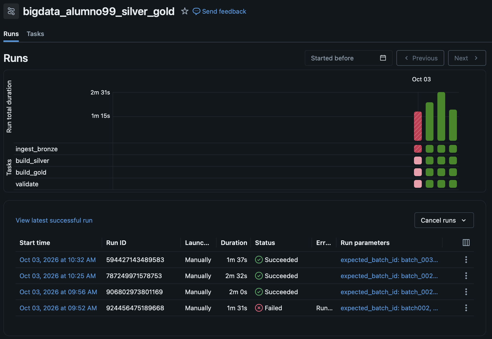
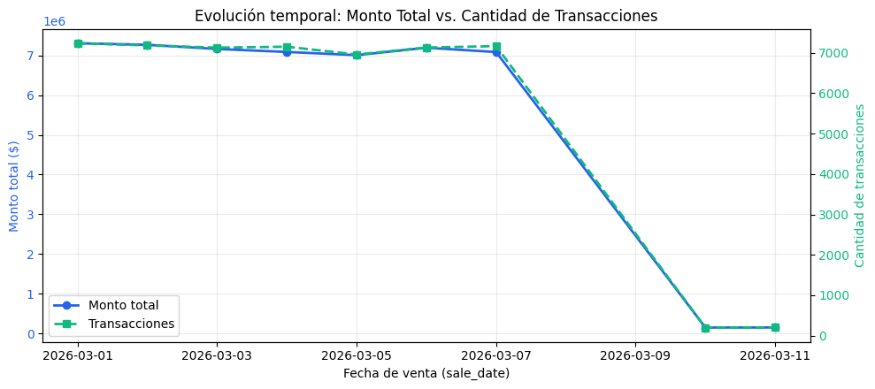
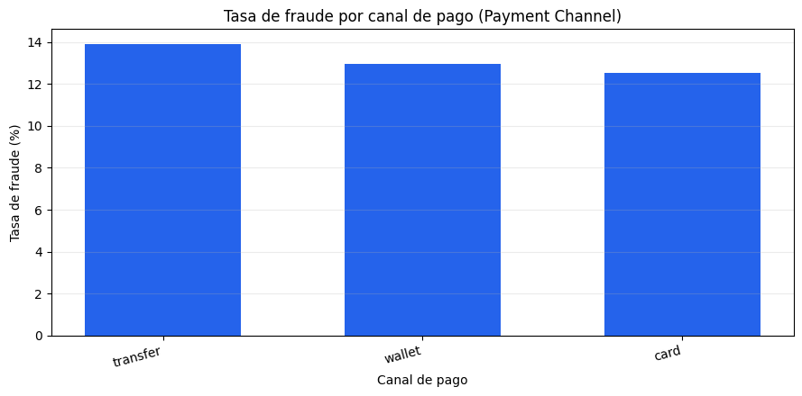
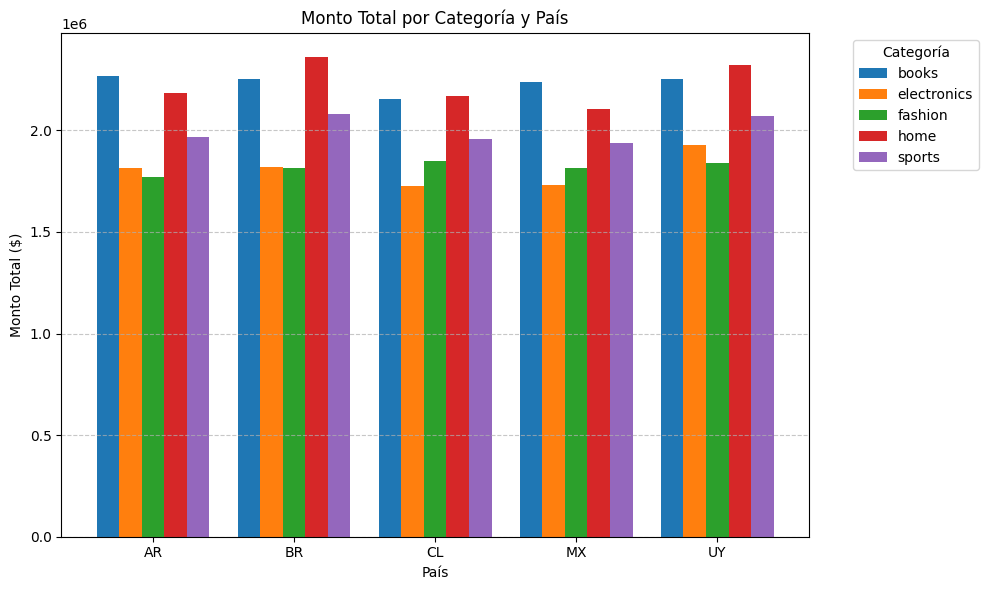
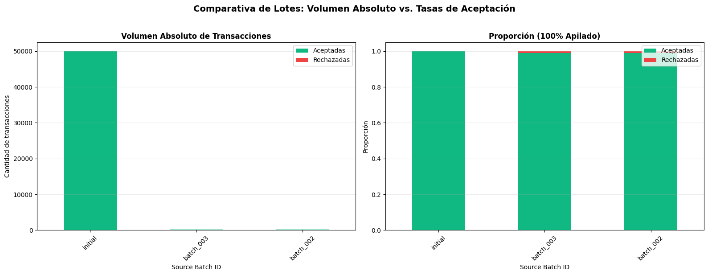

# Resolución Práctica 2
Nombre: Joaquin Santos

## DAG
student_id: `alumno99`

Nombre del DAG: `bigdata_alumno99_silver_gold`



Job: `924456475189668`
>Resultado: Error

Job: `906802973801169`
>Resultado: Éxito
>
>batch_002
>
>Aceptados: 200
>
>Rechazados: 2

Job: `787249971578753`
>Resultado: Éxito
>
>batch_002
>
>Aceptados: 200
>
>Rechazados: 2
>
>No hay cambios por idempotencia.

Job: `594427143489583`
>Resultado: Éxito
>
>batch_003
>
>Aceptados: 201
>
>Rechazados: 2

## Diferencia entre `COPY INTO` y `MERGE`
[`COPY INTO`](https://docs.databricks.com/aws/en/sql/language-manual/delta-copy-into) se utiliza para ingesta de datos de manera idempotente. Este recibe un directorio luego de la palabra `FROM` y toma archivos que aún no a procesado para agregar registros al final de la tabla destino. Por esto se usa en la capa de bronce.
En cambio, [`MERGE`](https://docs.databricks.com/aws/en/sql/language-manual/delta-merge-into) se usa en las capas posteriores ya que, requiere una condición y utiliza esta para ejecutar distinta lógica. Por ejemplo, para registros cuyo identificador ya existe en la tabla destino puedo actualizar los campos y para aquellos que aún no existen insertarlos.

## Tablas Gold

1) gold_batch_summary
Esta tabla agrega las transacciones por batch de carga. Provee detalles como cantidad aceptada, rechazada, el monto total de las transacciones y cantidad de ellas fraudulentas.

2) gold_customer_risk
Esta tabla agrega las transacciones por cliente. Contiene datos del cliente como país y segmento además de la cantidad de transacciones, monto total y promedio de estas y el riesgo calculado para él.

3) gold_daily_sales
Esta tabla agrega las transacciones por díe en el que sucedieron, el país, la categoría y el método de pago.

## Visualizaciones

1. **Pregunta:** ¿Qué día tuvo el mayor monto vendido y ese día también fue el de mayor cantidad de transacciones?

> **Respuesta**: El $2026-03-01$ tuvo el mayor monto vendido (*$7,310,840.77*) y la mayor cantidad de transacciones (*7236*).
> Los máximos coinciden, esto significa que el promedio del valor de las transacciones suele ser similar.

2) **Pregunta** ¿Qué canal de pago presenta la mayor tasa de fraude? ¿La conclusión se sostiene al considerar el número de transacciones de cada canal?

> **Respuesta**: *transfer* es el canal con mayor tasa de fraude (13.91%), con 2,327 fraudes sobre 16,723 transacciones totales.
>
>Promedio de transacciones por canal: 16,783.0
>La conclusión sí se sostiene de forma sólida. El canal *transfer* no solo tiene la mayor tasa, sino que su volumen de transacciones  está en línea con el promedio general.

3) **Pregunta:** ¿Qué combinación de país y categoría genera el mayor monto? ¿Existe una categoría dominante en todos los países o cambia según el mercado?


>
> **Respuesta**: *BR* es el país con mayor total_amount (*2,361,959.97*) en categoría (home). Esta categoría no es la dominante en todos los mercados como se ve a continuación.
>
>Ordenados por monto:
>
> País: BR | Categoría: home | Monto Total: $2,361,959.97
>
> País: UY | Categoría: home | Monto Total: $2,323,924.46
>
> País: AR | Categoría: books | Monto Total: $2,267,722.26
>
> País: BR | Categoría: books | Monto Total: $2,252,988.52
>
> País: UY | Categoría: books | Monto Total: $2,252,955.97
>
> País: MX | Categoría: books | Monto Total: $2,235,941.63
>
> País: AR | Categoría: home | Monto Total: $2,184,148.34
>
> País: CL | Categoría: home | Monto Total: $2,167,748.03
>
> País: CL | Categoría: books | Monto Total: $2,155,673.48
>
> País: MX | Categoría: home | Monto Total: $2,105,216.34
>
> País: BR | Categoría: sports | Monto Total: $2,079,532.92
>
> País: UY | Categoría: sports | Monto Total: $2,069,971.18
>
> País: AR | Categoría: sports | Monto Total: $1,966,346.81
>
> País: CL | Categoría: sports | Monto Total: $1,955,752.03
>
> País: MX | Categoría: sports | Monto Total: $1,940,040.26
>
> País: UY | Categoría: electronics | Monto Total: $1,929,855.99
>
> País: CL | Categoría: fashion | Monto Total: $1,847,582.51
>
> País: UY | Categoría: fashion | Monto Total: $1,841,459.93

4) **Pregunta:** ¿Qué proporción de cada lote fue aceptada y rechazada? ¿El lote nuevo presenta una calidad diferente del lote inicial?


> Comparar lotes de distintos tamaños no permite ver de manera clara las diferencias si solo evaluamos las proporciones. Se puede apreciar que 1 rechazado tiene mucho más impacto en la proporción de batch_002 y batch_003 que sobre initial por la cantidad total de transacciones.

## Preguntas de análisis y comprensión

1. Ambos batch (002 y 003) recibieron 204 filas físicas que son todas las filas que contienen cada uno de los archivos csv generados por *00_generate_new_batch.ipynb*.
```
SELECT
  `source_batch_id`,
  COUNT(`source_batch_id`)
FROM
  `workspace`.`bigdata_alumno99`.`bronze_transactions_incremental`
GROUP BY
  `source_batch_id`
```

2. 2 rechazados en batch_002 y batch_003, y 51 en initial. Si se corresponde, ya que hay un *amount* inválido y un *customer* desconocido que se introduce por cada batch que se genera y la tabla agregada de *gold* confirma los resultados.
```
SELECT
  `source_batch_id`,
  COUNT(`source_batch_id`)
FROM
  `workspace`.`bigdata_alumno99`.`silver_transactions_quarantine`
GROUP BY
  `source_batch_id`
```

```
SELECT
  `source_batch_id`,
  `accepted_transactions`,
  `rejected_transactions`
FROM
  `workspace`.`bigdata_alumno99`.`gold_batch_summary`
```

3. Se corresponden, se genera un duplicado, un amount inválido y un cliente desconocido por batch dentro del archivo *generate_incremental_data.py*. Esto confirma nuevamente los resultados del punto anterior:

```
SELECT
  `source_batch_id`,
  `quality_reason`
FROM
  `workspace`.`bigdata_alumno99`.`silver_transactions_quarantine`
GROUP BY `source_batch_id`, `quality_reason`
ORDER BY `source_batch_id`
```

|source_batch_id|quality_reason   |cantidad |
|:---:          |:---:            |:---:    |
|batch_002      |UNKNOWN_CUSTOMER	|1        |
|batch_002      |INVALID_AMOUNT	  |1        |
|batch_003      |INVALID_AMOUNT	  |1        |
|batch_003      |UNKNOWN_CUSTOMER	|1        |
|initial        |INVALID_AMOUNT	  |51       |

*common/generate_incremental_data.py:70*
```
# El mismo registro de negocio llega dos veces en el archivo.
rows.append(rows[0].copy())

invalid_amount = rows[1].copy()
invalid_amount.update(
    {
        "transaction_id": str(start_id + row_count),
        "amount": "N/A",
        "source_batch_id": batch_id,
    }
)
rows.append(invalid_amount)

unknown_customer = rows[2].copy()
unknown_customer.update(
    {
        "transaction_id": str(start_id + row_count + 1),
        "customer_id": str(config.rows["customers"] + 999),
        "source_batch_id": batch_id,
    }
)
rows.append(unknown_customer)
```

4. En `bronze_transactions_all` existen 3 registros para la transacción 42. La más reciente, dada por `updated_at` que pertenece al `batch_003`, es la que se encuentra en `silver_transactions` ya que la condición del *MERGE* determina que se trata de la misma transacción y la más versión reciente debe ser la que se refleja en *silver*.

```

SELECT
  `transaction_id`,
  `customer_id`,
  `event_ts`,
  `device_id`,
  `source_batch_id`,
  `updated_at`
FROM
  `workspace`.`bigdata_alumno99`.`bronze_transactions_all`
WHERE `transaction_id`=42
```
```
SELECT
  `transaction_id`,
  `customer_id`,
  `event_ts`,
  `device_id`,
  `source_batch_id`,
  `updated_at`
FROM
  `workspace`.`bigdata_alumno99`.`silver_transactions`
WHERE `transaction_id`=42
```

```
spark.sql(f"""MERGE INTO {transactions} t USING _valid_transactions s ON t.transaction_id = s.transaction_id
  WHEN MATCHED AND s.updated_at > t.updated_at THEN UPDATE SET *
  WHEN NOT MATCHED THEN INSERT *""")
```


5. Esta query no retorna ningún registro, por lo que no hay duplicados. Si en lugar de usar la tabla silver la ejecuto sobre *bronze_transactions_all* que contiene todas las transacciones, existen muchas transacciones cuyo id se encuentra más de una vez.

```
SELECT
  `transaction_id`,
  COUNT(`transaction_id`) AS `cantidad`
FROM
  `workspace`.`bigdata_alumno99`.`silver_transactions`
GROUP BY `transaction_id`
HAVING `cantidad` > 1
```

```
SELECT
  `transaction_id`,
  COUNT(`transaction_id`) AS `cantidad`
FROM
  `workspace`.`bigdata_alumno99`.`bronze_transactions_all`
GROUP BY `transaction_id`
HAVING `cantidad` > 1
```

6. Si es correcto depende de lo que se quiere analizar, ese ratio te puede mostrar rápidamente que porcentaje de un lote en particular fallaron. Pero, al comparar lotes de distinto tamaño no es lo mismo. Son ratios muy distintos pero la misma cantidad para un lote en el que fallaron 5000 de 100000 (5%) y otro en el que fallaron 5000 de 10000 (50%).

|source_batch_id|arej_rate            |
|:---:          |:---:                |
|initial        |0.0010200204004080081|
|batch_003      |0.009852216748768473 |
|batch_002      |0.009900990099009901 |

```
WITH base_transactions AS (
    SELECT 
        *,
        (`accepted_transactions` + `rejected_transactions`) AS `total_trans`
    FROM `workspace`.`bigdata_alumno99`.`gold_batch_summary`
)
SELECT 
    *,
    CASE 
        WHEN `total_trans` > 0 THEN `accepted_transactions` / `total_trans` 
        ELSE 0.0 
    END AS acc_rate,
    CASE 
        WHEN `total_trans` > 0 THEN `rejected_transactions` / `total_trans` 
        ELSE 0.0 
    END AS arej_rate
FROM base_transactions
ORDER BY acc_rate DESC;
```

7. El día de mayor monto total y mayor cantidad de transacciones coincide y es el *2026-03-01*, con un monto total de *7310840.77* y *7236* transacciones.

```
SELECT 
    sale_date,
    SUM(total_amount) AS total_amount,
    SUM(transaction_count) AS total_transaction_count
FROM `workspace`.`bigdata_alumno99`.`gold_daily_sales`
GROUP BY sale_date
ORDER BY sale_date ASC;
```

8. El canal de pago con mayor tasa global de fraude con un valor de *13.91%* es *transfer*. No corresponde promediar directamente *fraud_rate* ya que si es muy disproporcionada la cantidad de transacciones de un medio respecto al resto se distorsiona el valor real ya que se les da el mismo peso a todos ellos.

```
SELECT 
    payment_channel,
    SUM(fraud_transactions) AS fraud_transactions,
    SUM(transaction_count) AS transaction_count,
    CASE 
        WHEN SUM(transaction_count) > 0 THEN CAST(SUM(fraud_transactions) AS DOUBLE) / SUM(transaction_count)
        ELSE 0.0 
    END AS fraud_rate
FROM `workspace`.`bigdata_alumno99`.`gold_daily_sales`
GROUP BY payment_channel
ORDER BY fraud_rate DESC;
```

9. La combinación país categoría con mayor monto vendido es *Brasil* y *Home*.
Para cada país es el monto total máximo:

|category |country|total_amount |
|:---:    |:---:  |:---:        |
|home     |BR     |2361959.97   |
|home     |UY	    |2323924.46   |
|books    |AR     |2267722.26   |
|books    |MX     |2235941.63   |
|home     |CL     |2167748.03   |

```
WITH AggregatedSales AS (
    SELECT 
        category,
        country,
        CAST(SUM(total_amount) AS DOUBLE) AS total_amount,
        ROW_NUMBER() OVER (PARTITION BY country ORDER BY SUM(total_amount) DESC) AS rn
    FROM `workspace`.`bigdata_alumno99`.`gold_daily_sales`
    GROUP BY category, country
)
SELECT 
    category,
    country,
    total_amount
FROM AggregatedSales
WHERE rn = 1
ORDER BY total_amount DESC;
```

10.  Las métricas comparadas para evaluar idempotencia si el último batch id es igual al expected son las siguientes: `(prior.silver_rows, prior.quarantine_rows, prior.gold_rows, prior.gold_total_amount)`. 
En la columna *idempotence_compared* de *pipeline_run_audit* se guarda si es que se realizó la comparación de idempotencia.

11. Para evitar cargar el mismo archivo múltiples veces ya que se supone que el contenido de los archivos ya procesados se encuentra en *bronze*. [`COPY INTO`](https://docs.databricks.com/aws/en/sql/language-manual/delta-copy-into) utiliza los nombres de los archivos así que incluso si se hubiese modificado el archivo, no se volverá a cargar.

12. Porque esta vista lee y guarda todos los registros (append-only), usar *UNION ALL* no es costoso computacionalmente y esta capa se supone que debe tener todos los registros para no perder trazabilidad. Luego se resuelven los duplicados (y se limpian los datos) para la capa silver, en este caso utilizando el más reciente basado en *updated_at*, para escribirlos en *silver_transactions*. 

13. Utilizan *event_ts* como *updated_at* ya que se supone que es cuando el dato se originó y correciones tendrán timestamps posteriores. De esta manera cualquier correción que se haga sobre el dato podrá ser detectada y aplicada fácilmente por *MERGE INTO*.
La transacción 42 fue corregida dos veces: primero en el batch 002 y después en el 003. Los valores de *updated_at* corresponden a timestamps posteriores, y aunque no siempre es así para el *event_ts* ni es relevante, en este caso también lo son.

14. La ventaja del *try_cast* es que intenta realizar la transformación a otro tipo, pero si falla retorna *NULL* en lugar de un error. Esto se hace para que el pipeline no termine abruptamente con un error que es lo que sucedería con un *cast*.

15. Es importante el orden de las condiciones ya que si hubiera más de una de las reglas que se rompe, al evaluarse todas solo queda como causa la primera de ellas que se rompa. (El primer caso *WHEN* evaluado como verdadero en *quality_rules*) Esto sucede ya que *WHEN* evalúa casos secuencialmente hasta que uno de ellos se cumpla, asigna el valor en este caso y no evalúa el resto.

16. El record_key intenta usar el *transaction_id_typed* como String si no es nulo, si fuese nulo concatena las columas (reemplazando nulos) y aplica una función de hash ya que al carecer de un identificador único debemos crear uno. Esta es una manera de crearlo a partir de los datos compatible, sencilla y reproducible. Si llegase un registro exáctamente igual aparte de representar aparentemente lo mismo, aplicar la misma función devuelve el mismo resultado.

17. Se actualiza una fila existente cuando se encuentra el mismo *transaction_id*, y se inserta como nuevo cuando está ausente. La condición evaluada para decidir si actualizar los valores una vez que hay coincide el id es si el campo updated_at tiene un timestamp más reciente.

```
MERGE INTO {transactions} t USING _valid_transactions s ON t.transaction_id = s.transaction_id
WHEN MATCHED AND s.updated_at > t.updated_at THEN UPDATE SET *
WHEN NOT MATCHED THEN INSERT *
```

18. La tabla silver se actualiza ya que en ella se corrigen errores y contiene todos los registros (limpios y deduplicados). En cambio las tablas gold están agregadas y contienen KPIs por lo que un cambio particular cambia el contenido ya que debe ser recalculado.
Una ventaja es que solo se procesan y escriben datos que cambiaron o son nuevos en silver y en gold los datos son siempre consistentes con las reglas de negocio. Como desventaja, a medida que incrementa el volumen historico se requieren más recursos para recalcular gold.

19. *expected_batch_id* no participa en la detección de nuevos archivos ya que de eso se encarga *COPY INTO*. Este parametro se utiliza para verificar que en la tabla incremental se encuentra el batch que uno esperaba procesar. Es decir que es unicamente una validación en la capa de bronce que valida que el batch llego y luego también forma parte de las validaciones generales en *04_validate_pipeline*.

20. Si un run falla en alguna etapa, el resto no continúa como por ejemplo mi primer ejecución en la que el parametro *batch_id* tenía un valor incorrecto. El DAG construido tiene 4 etapas, bronze, silver, gold y validation, ejecutadas de manera secuencial en el mismo orden ya que los resultados de una son usados como entrada en la siguiente. Fallar en cualquiera de ellas provoca que no se continúe con los pasos posteriores. De esta manera, si hay algún error en una capa inicial no es necesario crear las tablas gold con valores incompletos/erróneos y mucho menos validar que estos sean correctos.
